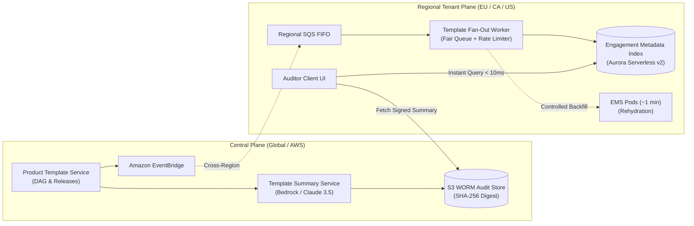
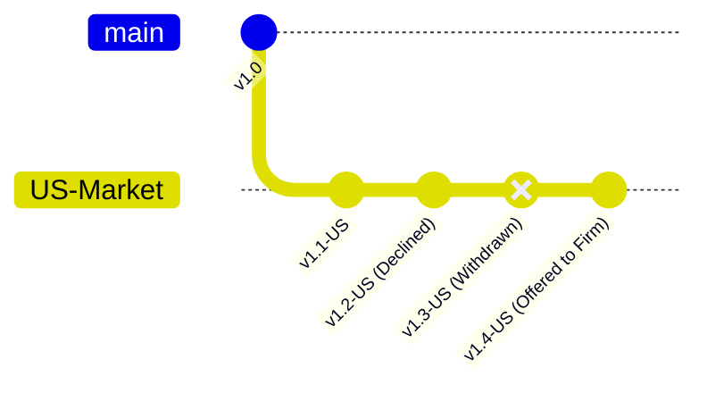

# Architecture Design Document: Real-Time Product Template Updates Platform

**Author:** Andrés Felipe Buitrago Feria — Staff Backend / Cloud Architect  
**Scope:** Real-Time Template Inbound Notification & Auditable Update System  
**Constraint Target:** 2–4 Pages (Diagrams excluded from page count)  
**Date:** October 2026 | Version 1.1

---

## 1. Architecture and Data Ownership

To deliver real-time responsiveness without violating data residency or overloading legacy pods, the system decouples into two planes: a **Global Central Plane** (for shared templates and summaries) and an **In-Region Tenant Plane** (for client-confidential audit workpapers).



### 1.1 Data Ownership Matrix & Boundaries

| Bounded Context | Authoritative Data Owned | Tenancy & Storage | Residency Boundary |
| :--- | :--- | :--- | :--- |
| **Product Template Service (PTS)** | Template zip archives, structured JSON, Version DAG, market branches. | Central Global (S3 + Aurora PostgreSQL) | Global (US-East) |
| **Template Summary Service (TSS)** | Deterministic diffs, human summaries, cryptographic signatures. | Central Global (S3 Object Lock + DynamoDB) | Global (US-East) |
| **Engagement Metadata Index (EMI)** | `(firm_id, engagement_id, product_id, current_ver, declined_vers)`. | Regional Multi-Tenant (Aurora Serverless v2) | Strict In-Region (EU / CA) |
| **Engagement Management System (EMS)** | Client workpapers, volatile financial fields, memory session state. | Customer-Isolated (Encrypted Blob Storage) | Strict In-Region (EU / CA) |

*Data Sovereignty Guarantee:* Client audit workpapers **never cross regional borders** or enter central LLM prompts. Only generic product template JSON diffs are processed centrally.

---

## 2. Correctness and Production Evolution

### 2.1 Non-Linear Versioning DAG: Branching, Withdrawals & Accumulation



1. **What "Declined" Actually Pins:**
   - Declining an update (e.g., $v_5$) does not sever the engagement from future updates.
   - It sets `current_pinned_version = v4` and appends $v_5$ to `declined_versions`. It pins acceptance of state $v_4$ and specific rejection of delta $\Delta(v_4 \to v_5)$.
2. **Accumulating Updates ($v_4 \to v_7$):**
   - When $v_7$ is published, the DAG engine identifies the shortest valid path from pinned $v_4$ to head $v_7$.
   - The user receives a **Cumulative Composite Summary** ($\Delta(v_4 \to v_7)$) explicitly stating: *"Includes revisions from previously declined version v5 plus new updates in v6 and v7."*
3. **Withdrawn Versions:**
   - If content teams mark $v_6$ as withdrawn, PTS publishes `TemplateVersionWithdrawnEvent(v_6)`.
   - Regional EMI instances clear pending notifications for $v_6$. Engagements that already applied $v_6$ are flagged for remediation via hotfix $v_7$.

### 2.2 Zero-Downtime Migration & Non-Disruptive Backfill

With 800,000 legacy engagements trapped in unqueryable blobs and no maintenance window:
* **Phase 1: Opportunistic Dual-Write (Day 0–14):** A post-hydration hook is added to live EMS pods. When users naturally open files, the pod writes `(firm_id, engagement_id, template_id, version)` to the regional EMI. Covers ~60% of active files with zero added background load.
* **Phase 2: Controlled Background Crawl (Day 15–30):** The Java Fan-Out Worker crawls remaining un-indexed files during off-peak hours (10 PM – 5 AM local firm time), throttled to 15 concurrent downstream calls per region.
* **Phase 3: EMI Cutover:** All dashboard queries read from EMI. Rehydration is completely eliminated from the notification path.

### 2.3 Unreliable Event Delivery & Idempotency
* **At-Least-Once Delivery:** Deduplicated via deterministic key: `SHA256(engagement_id + target_version + release_id)`.
* **Out-of-Order Events:** DAG topological depth comparison; older events arriving after newer versions are safely ACKed and discarded.
* **Failure Recovery:** 3 exponential backoff retries with full jitter for transient 429/503 errors; poison pills and permanent 400s route directly to a Dead-Letter Queue (DLQ).

---

## 3. Scale, Cost, and Operational Arithmetic

### 3.1 Downstream Bottleneck: The Impossibility of Eager Processing
* **Scale:** 4,000 firms, 800,000 engagements across 40 products $\implies$ average 20,000 files/product (largest firm has 40,000).
* **Downstream constraint:** ~1 minute rehydration per file, limited pod capacity ($\le 15$ concurrent).
* **Sequential Wall-Clock Time:** $20,000 \times 1\text{ min} = 20,000\text{ min} \approx \mathbf{333.3\text{ hours (13.8 days)}}$.
* **Parallel Wall-Clock Time (at capacity limit):** $\frac{20,000 \text{ files}}{15 \text{ pods}} \times 1\text{ min} = 1,333.3\text{ min} \approx \mathbf{22.2\text{ hours}}$ (or $\mathbf{44.4\text{ hours}}$ for 40,000 files).
* *Conclusion:* Eagerly evaluating engagements upon template publication is an architectural failure.

### 3.2 The Decoupled Staff Solution: $O(1)$ Publish + $O(1)$ Dashboard Query
1. **On Template Publish ($O(1)$ compute):** TSS generates the JSON diff and LLM summary **once** for the updated template in **< 5 seconds**.
2. **On Dashboard View ($O(1)$ read):** Client queries the regional EMI:

```math
\text{Pending Update} = (\text{template\_head} > \text{engagement.version}) \land (\text{template\_head} \notin \text{engagement.declined\_versions})
```

Execution time: **< 8 milliseconds** via indexed B-Tree on `(firm_id, product_id)`.

### 3.3 Data Footprint & Financial Run Cost Breakdown

* **EMI Storage Arithmetic:** 800,000 rows $\times$ ~250 bytes $\approx \mathbf{201.6\text{ MB}}$ total ($\lt 85\text{ MB}$ per region). Fits entirely in RAM.

| Component | Usage / Metric | Monthly Cost |
| :--- | :--- | :--- |
| **LLM Inference (AWS Bedrock Claude 3.5 Sonnet)** | 40 products $\times$ 4.3 wks = 173 base diffs + ~600 common multi-hop paths = **773 calls/mo** (5k in / 600 out tokens) | **\$18.55 / mo** |
| **Aurora Serverless v2 (Regional EMI)** | 3 Regional DBs (EU, CA, US), 0.5–2 ACUs auto-scaled | **\$260.00 / mo** |
| **ECS Fargate Workers (Fan-Out & Event Handlers)** | 3 Regional Tasks (0.5 vCPU, 1 GB RAM) | **\$65.00 / mo** |
| **EventBridge + SQS + S3 Object Lock** | 1.5M messages/mo + 50 GB WORM audit store | **\$1.75 / mo** |
| **CloudWatch & Splunk Telemetry** | Metrics, Distributed Traces, Alarms | **\$85.00 / mo** |
| **TOTAL ALL-IN RUN COST** | **All 4,000 Firms / 800,000 Engagements** | **\$430.30 / mo** |

*Cost Impact:* Generating summaries at the **template level** reduces monthly LLM spend from **\$19,200/mo** (naive per-engagement approach) to **\$18.55/mo** (a **99.9% cost reduction**).

---

## 4. Generation and Evaluation of Human-Readable Summaries

### 4.1 Ingestion, Guardrails, and Evaluation Pipeline
1. **Deterministic Normalization:** Raw JSON diffs are stripped of syntactic noise (internal GUIDs, UI layout offsets) and categorized into audit taxonomy: *Disclosures*, *Procedures/Checklists*, *Formulas/Materiality*, *Guidance*.
2. **Deterministic LLM Output:** Executed via Claude 3.5 Sonnet at `temperature: 0.0` with strict JSON schema output contracts.
3. **Evaluation Harness:** Automated fact-checking parses LLM outputs and verifies that every workpaper reference exists in the source diff. Continuous CI/CD validation scores diffs against a Golden Benchmark suite of 50 historic releases (ROUGE-L $\ge 0.92$).

### 4.2 Defending a March Decision in a November Regulatory Review
* **The Regulatory Requirement:** An auditor declines an update in March; in November, regulators (PCAOB / IAASB) inspect why standard audit procedures were omitted.
* **Architectural Invariant:** **Never query an LLM dynamically during an audit inspection.**
* **The Forensic Provenance Bundle:**
  1. Summaries are stored in **S3 Object Lock (Compliance Mode WORM)** with an immutable SHA-256 digest.
  2. The partner's decision ledger records: `(engagement_id, user_id, action: DECLINED, timestamp: 2026-03-12T14:22Z, summary_digest: sha256:e3b0c44...)`.
  3. In November, the system reconstructs the exact byte-for-byte summary shown in March. Re-prompting LLMs is prohibited.

---

## 5. Tradeoffs, Assumptions, and Requirement Challenge

### 5.1 The Requirement I Challenge
* **Requirement Challenged:** *"Product would like this to be available in real time — within seconds of a template being published [by evaluating engagement files]."*
* **Why:** Rehydrating 20,000–40,000 files downstream requires **22 to 44 hours**. Eager processing would crash live user sessions.
* **Staff Alternative:** Template diffing and summarization complete in **< 5 seconds** at publish time; pending indicators render **in < 10 ms** on dashboard load via the regional EMI index.

### 5.2 Key Architectural Tradeoffs
* **Template-Level Summarization vs. Per-Engagement:** Summarizing at the template level cuts LLM costs by 99.9% (\$18.55 vs \$19.2k/mo) and ensures consistent advice across firms.
* **Adaptive Semaphore vs. Unbounded Threads:** Uses a strict capacity throttler (max 15 permits) rather than thread pool sizing to protect external downstream pods from cascading OOMs.
* **Fair Tenant Scheduling vs. FIFO:** Deficit Round-Robin scheduling prevents the 40,000-engagement firm from starving median 40-engagement firms.

### 5.3 Risk Analysis & Deliberate Exclusions
* **Riskiest Element to Get Wrong:** *Tenant Starvation under Skew.* A single enterprise firm update could saturate downstream workers for days if queued naively in FIFO.
* **Deliberately Left Out:**
  1. *Automated Schema Merging:* Merging audit procedures requires human partner judgment and is excluded per scope.
  2. *Vector Databases / RAG:* Structured JSON schema deltas do not benefit from semantic vector search; vector embeddings introduce hallucination risks without value.

### 5.4 Observability & SLOs
* **SLOs:** Dashboard indicator latency $p99 \lt 50\text{ ms}$; Template summary generation $p99 \lt 15\text{ s}$; Downstream error rate < 0.1%.
* **Observability:** Distributed tracing (W3C `traceparent`) across SQS and downstream calls; CloudWatch alarms trip circuit breakers if downstream 5xx errors exceed 25% over 2 minutes.

---
*End of Design Document.*
