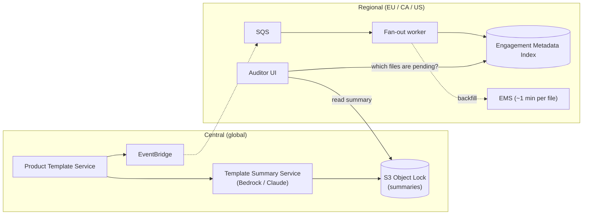
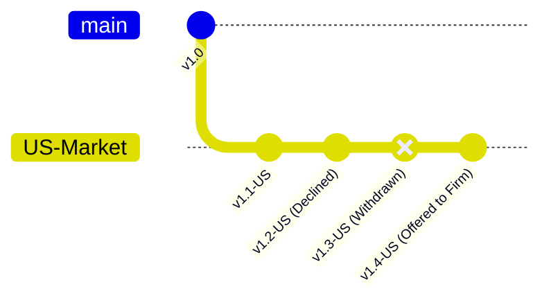

# Architecture Design: Pending Template Updates

**Author:** Andrés Felipe Buitrago Feria · **Date:** October 2026

## 1. Architecture and Data Ownership

Opening an engagement takes about 1 minute, so we can't open files to find out which ones have pending updates. Instead, we keep a small index per region with each engagement's template version, and the dashboard reads from it.

The system has two parts:

- **Central (global):** templates and their summaries. Template content isn't firm-specific, so it can live in one place.
- **Regional (EU / CA / US):** anything tied to customer engagements. It never leaves its region.

| Component | Owns | Where |
| :--- | :--- | :--- |
| Product Template Service | Template files, versions, market branches | Global |
| Template Summary Service | Diffs and human-readable summaries | Global |
| Engagement Metadata Index (EMI) | `firm_id, engagement_id, product_id, current_version, declined_versions` | In-region |
| Engagement Management System (EMS) | Engagement content, accept/decline | In-region |

Customer workpapers never leave their region and are never sent to an LLM. Only template diffs are summarized.

## 2. Correctness and Production Evolution

Versions don't form a straight line. Markets branch, versions get withdrawn, and a later version can include an earlier one.

- **What "declined" means:** if a user declines v5, the engagement stays on v4 and v5 is recorded as declined. The engagement still receives future updates.
- **Several updates before a decision:** if v5, v6 and v7 come out before the user decides, they see one update, from v4 to v7, with one combined summary. The summary says which changes came from the v5 they declined.
- **Withdrawn versions:** if v6 is withdrawn, it stops showing as pending. Engagements that already applied it are flagged for the content team.

**Migration (no maintenance window, 800,000 existing engagements):**

1. **Weeks 1–2, fill the index as files are opened:** when a user opens an engagement, we write its template version to the index. This adds no extra load. We expect about 60% of files to be covered this way.
2. **Then, fill the rest in the background:** the worker opens the remaining files at night, at most 15 at a time per region. That's 320,000 files × 1 min ÷ 45 (15 × 3 regions) ≈ 118 hours, about 17 nights.
3. **Then, switch over:** the dashboard reads only from the index.

**Duplicate or lost events:** each unit of work has a key (engagement + version + release), so a repeated event is skipped. Temporary errors are retried 3 times with backoff. Permanent errors go to a dead-letter queue.

## 3. Scale, Cost and Operations

**Why not check every engagement when a template is published:** 800,000 engagements ÷ 40 products = 20,000 per product. At 1 minute each and 15 at a time, that's 20,000 ÷ 15 ≈ 1,333 minutes, about 22 hours per publish. The largest firm alone (40,000 engagements) would take about 44 hours.

**What we do instead:**

- **On publish:** generate the diff and the summary once per template version, in a few seconds.
- **On dashboard load:** one indexed query on the regional index. A file is pending if the latest version is newer than its current version and the user hasn't declined it.

**Size and cost:**

- Index: 800,000 rows × ~250 bytes ≈ 200 MB in total. It fits in memory.
- LLM: about 773 summaries a month (173 one-step diffs + ~600 multi-step ones), at roughly \$0.024 each.

| Component | Basis | Monthly |
| :--- | :--- | ---: |
| LLM (Bedrock, Claude 3.5 Sonnet) | ~773 calls, 5k input / 600 output tokens | \$18.55 |
| Aurora Serverless v2 (index) | 3 regions, 0.5–2 ACU | \$260.00 |
| ECS Fargate workers | 3 tasks, 0.5 vCPU / 1 GB | \$65.00 |
| EventBridge, SQS, S3 Object Lock | ~1.5M messages, 50 GB | \$1.75 |
| Monitoring | Metrics, traces, alarms | \$85.00 |
| **Total** | | **\$430.30** |

One summary per engagement instead of per template would cost about \$19,200/month.

**SLOs:** dashboard p99 under 50 ms; summary ready within 15 s of publish; downstream error rate under 0.1%. Alerts fire when downstream 5xx errors exceed 25% for 2 minutes.

## 4. Human-Readable Summaries

**How a summary is made:**

1. Clean the JSON diff (remove IDs and layout noise) and group changes into disclosures, procedures, formulas/materiality and guidance.
2. Ask the LLM for a summary in a fixed JSON format, at temperature 0.
3. Check it automatically: every item it mentions must exist in the diff. We also test against 50 past releases.

**Defending a March decision in November:**

- Each summary is saved once, in S3 Object Lock (it can't be changed or deleted), with a SHA-256 hash.
- When a user declines, we record who, when, and the hash of the summary they saw.
- In November we show the exact summary from March. We never regenerate it with the LLM.

## 5. Tradeoffs, Assumptions and Challenge

**Requirement I challenge: "real time, within seconds", if it means checking each engagement on publish.** That takes 22–44 hours per publish. We meet "seconds" by preparing the summary at publish time and answering the dashboard from the index, not by checking every file.

**Tradeoffs:**

- One summary per template instead of per engagement: much cheaper, and every firm sees the same text.
- A hard limit on downstream calls (15) instead of relying on thread pool size: protects the other team's pods.
- A fair queue per firm instead of a single FIFO queue: a firm with 40 files isn't stuck behind one with 40,000.

**Assumptions:** 15 concurrent downstream calls per region; about 60% of files are opened within two weeks.

**Riskiest part:** one large firm blocking everyone else. A single FIFO queue would keep small firms waiting for days, so the worker takes a few files from each firm in turn.

**Left out on purpose:**

- Applying updates automatically: that needs an auditor's judgment, and it's out of scope.
- Vector search / RAG: diffs are structured JSON, so semantic search adds risk without benefit.
