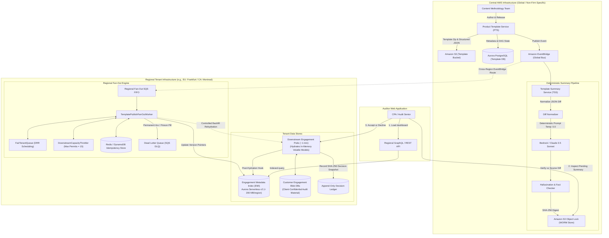
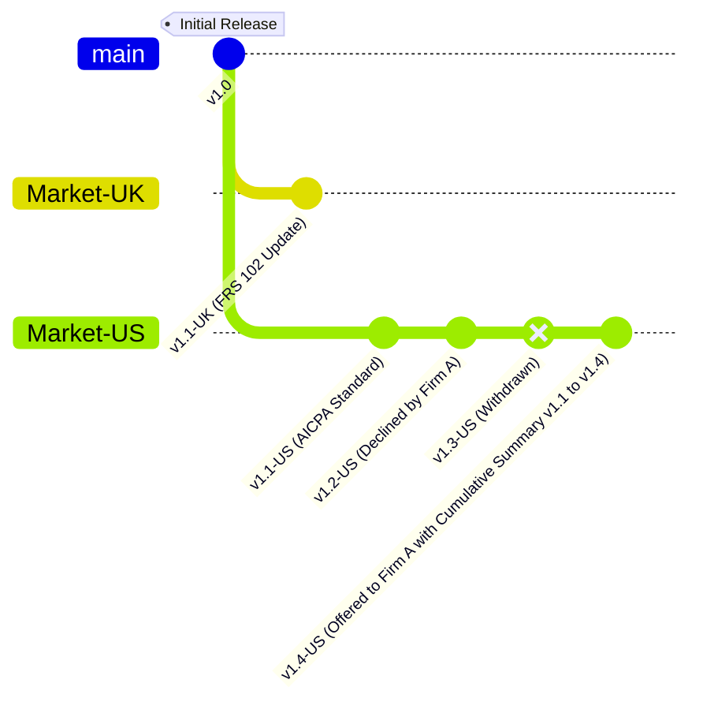
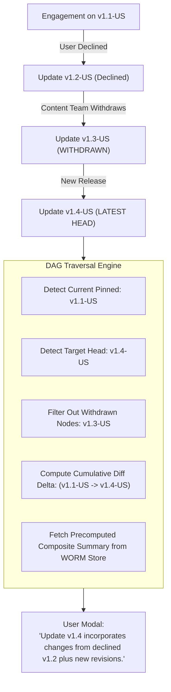
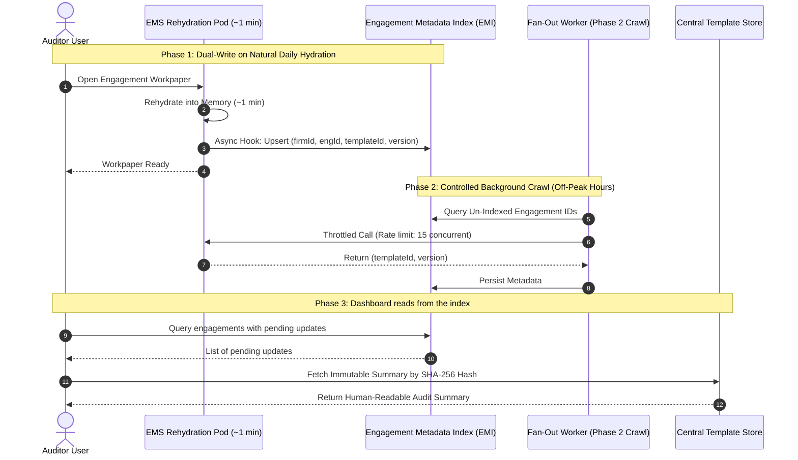
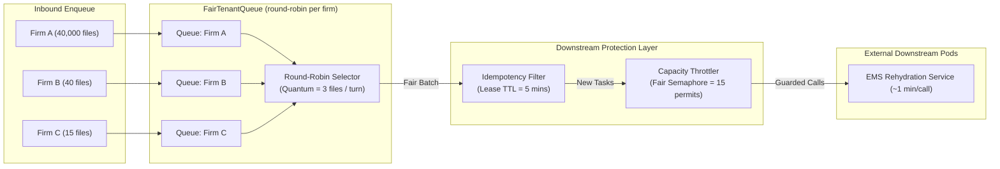

# Architectural Diagrams & Visual Reference Models

**System:** Real-Time Product Template Updates Platform  
**Author:** Andrés Felipe Buitrago Feria  
**Context:** Staff Architecture Design Exercise  

---

## 1. High-Level System Architecture & Tenant Boundaries

---

## 2. Non-Linear Versioning DAG & Update Accumulation

### Cumulative Summary Flow for Skipped / Declined Updates

---

## 3. Zero-Downtime Migration & Non-Disruptive Backfill Flow

---

## 4. Fair Multi-Tenant Queue Dispatcher Pipeline

